<p align="center">
  
</p>

```YAML
nyemoon@github ~ [session: active]
```

```bash
$ whoami
```

```YAML
Ketlyn Barbosa
alias:      Nyemoon

"O sol simplesmente é o que ele foi feito pra ser"
```

```bash
$ cat skills.conf
```

```ini
[focus & roles]              Frontend UI/UX · Responsive Design · Data & Machine Learning · Open-Source
[languages]                  Python · JavaScript (ES6+) · HTML5 · CSS3 · SQL
[frontend]                   React · Vue · Vite · Bootstrap
[backend & apis]             Django · Node.js · REST API
[data science & ml]          Pandas · NumPy · Scikit-learn · Matplotlib · TF-IDF
[apps & prototyping]         Streamlit · Gradio
[testing & ci]               pytest · GitHub Actions · CI/CD
[database & cloud]           MySQL · Oracle Cloud
```

```bash
$ ls projects/
```

<p align="center">
  
</p>

<p align="center">
  <a href="https://github.com/Nyemoon/Data_Pipeline_Validator"><b>💜 Data_Pipeline_Validator</b></a>
  &nbsp;·&nbsp;
  <a href="https://github.com/Nyemoon/May"><b>💜 May</b></a>
</p>

```bash
$ cat phase.sh --progress
```

<p align="center">
  
</p>

```bash
$ _
```

<br/>

<div align="center">
  <a href="https://www.linkedin.com/in/ketlyn-barbosa-a995833aa">
    
  </a>
  &nbsp;&nbsp;
  <a href="https://github.com/Nyemoon">
    
  </a>
  &nbsp;&nbsp;
  <a href="mailto:ketlynbarbosa783@gmail.com">
    
  </a>
</div>